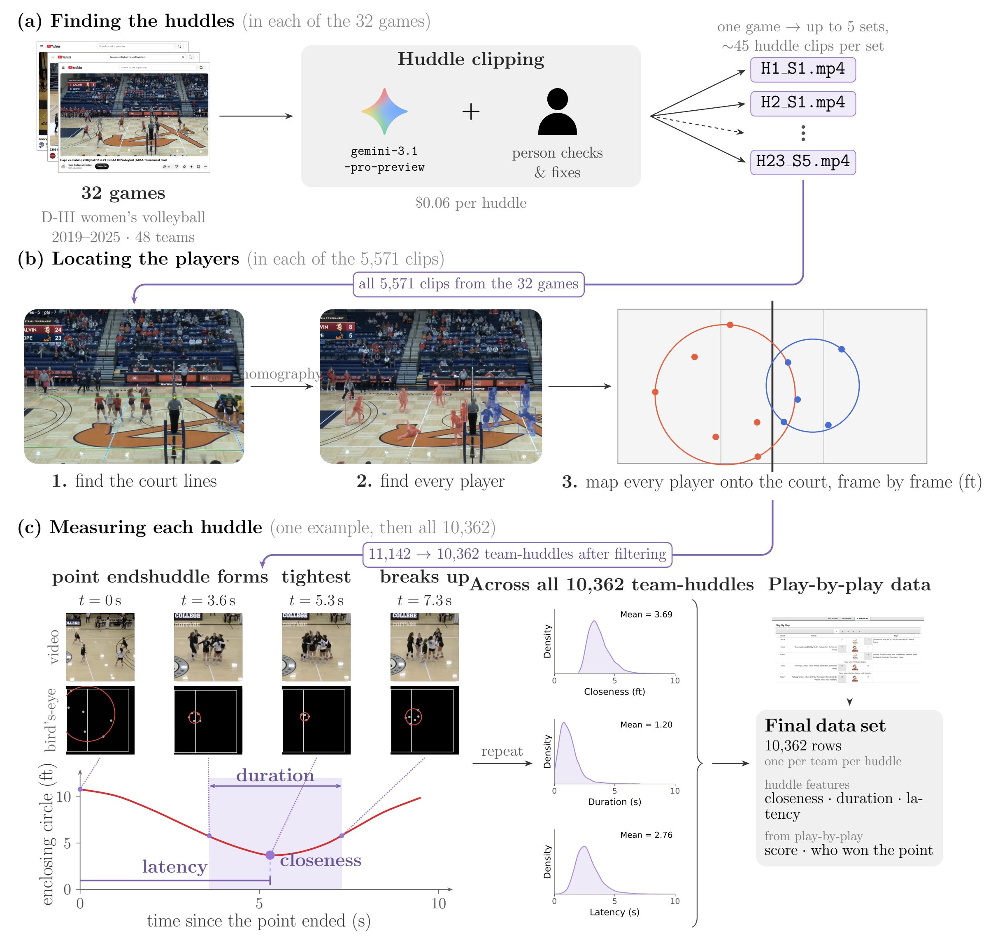

# Team Recovery after Setback 

**How do teams regroup in the seconds after a setback, and does how they regroup relate to their performance?**


This repository is our research artifact for our submission to Organization Science special issue: AI-Enabled Frontiers in Organizational Science. We develop an AI-centered pipeline to empirically measure how teammates regroup following setbacks. When regrouping, teams often huddle in preparation for future performances. We use college volleyball as our model system to extract thousands of huddling moments. Our work analyzes the behavior of teammates during these huddling moments through how fast they come together (latency), how close they come together (closeness), and how long they stay together (duration). 


## Pipeline



**a) Finding the huddles.** A multimodal LLM (`gemini-3.1-pro-preview`) identify start and stop times for every post-point huddle across an entire game. The final times live in `stimulus_map.csv`, and each huddle clip is cut from the game's YouTube video using them. Clips are named like `huddle_1_set_1.mp4`.

**b) Locating the players** (`analysis/modeling/sam3_automation.py`, per-game settings in `analysis/modeling/parameters.csv`). Every clip goes through SAM 3 in two steps: find the court lines to build the homography, then detect and track every player. This gives each player's court position in every frame, saved as `data/<matchup>/all_sets.csv`.

**c) Measuring each huddle** (`analysis/feature_extraction/build_dataset.py`, which uses `create_additional_features.py`). For each team in each huddle, the frame-by-frame positions are measured with three features: closeness, duration and latency. The script also scrapes any missing `data/<matchup>/play_by_play.csv`, which supplies the score and who won the point. Together these give `data/long_dataset.csv`, one row per team-huddle.

**Analysis and figures** (not in the figure)
- `analysis/statistical_analysis/huddle_feature_analysis.py` prints every result reported in the paper and writes `results/*.csv`.
- `analysis/statistical_analysis/paper_figures.py` redraws the paper's result figures into `overleaf/images/`.


## Step 1: Set up environment 

Requires Python 3.10+. All of the data necessary for the following steps is already aggregated in this repository. There will be no re-running of the gemini huddle clipping or computer vision tracking steps. 

1. **Clone the repo and enter it**
   ```
   git clone <repo_url>
   cd <repo_name>
   ```
2. **Create a project-specific environment**
   ```
   python3 -m venv .venv
   ```
3. **Activate it, then install the packages**
   ```
   source .venv/bin/activate          # Windows: .venv\Scripts\activate
   pip install -r requirements.txt
   ```
   Your prompt should now start with `(.venv)`. If it shows `(base)`, run `conda deactivate` first and activate again.
4. **Check that everything installed correctly** (should print `ok`)
   ```
   python -c "import numpy, pandas, scipy, statsmodels, sklearn, matplotlib, ipykernel; print('ok')"
   ```

**Which requirements file?** `requirements.txt` covers everything in the paper (analysis, figures, `demo.ipynb`) and is the only one you need. `requirements-sam3.txt` is only for re-running the video tracking (`sam3_automation.py`), which requires GPU. 

## Step 2: Run the demo.ipynb
1. **Register the environment as a notebook kernel** 
   ```
   python -m ipykernel install --user --name team-recovery --display-name "Team Recovery"
   ```
3. **Open `demo.ipynb`** in VS Code or Jupyter and pick the kernel **Team Recovery** (VS Code: top-right "Select Kernel" > Jupyter Kernel, or Python Environments > `.venv`). If it is not listed, reload the window or choose "Enter interpreter path" and point to `.venv/bin/python`.
4. **Run the cells top to bottom.** Later cells use data loaded by earlier ones. Open the notebook from the repo root so relative paths (`data/`, `demo/`) resolve.

## Optional: Reproduce the paper's results
In addition to rerunning the demo which already has all of the values and figures referenced in the paper, you can output just those values with their respective scripts.

Run from the repo root with the environment active:
```
python3 analysis/statistical_analysis/huddle_feature_analysis.py   # prints all findings; writes results/*.csv
python3 analysis/statistical_analysis/paper_figures.py             # redraws the figures (needs the results/ files above)
python3 analysis/feature_extraction/build_dataset.py               # optional: rebuild data/long_dataset.csv
```

## Computer Vision Huddle Video

### Full Set Rendered

[](https://www.youtube.com/watch?v=6PgvWIfWrck)


### Features

The following demos aim to clarify how the three huddle features were generated with the computer vision model. 

1) Closeness

Closeness is the closest the team gets during the huddle: the diameter (in feet) of the enclosing circle, anchored at the minimum-gyration frame, taking the smallest value over all frames.

[](https://www.youtube.com/shorts/AXzlwPiRrUI)

2) Duration

Duration is how long the team stays together. It is the time, in seconds, of the longest stretch in which the team stays within 1.5 times the dataset's median radius.

[](https://www.youtube.com/shorts/NaJwz33QBa0)

3) Latency

Latency is how long the team takes to come together: the elapsed time from the team's first tracked spread to its eventual closest value, controlled for starting position.

[](https://www.youtube.com/shorts/r5PkqzfFOAw)
